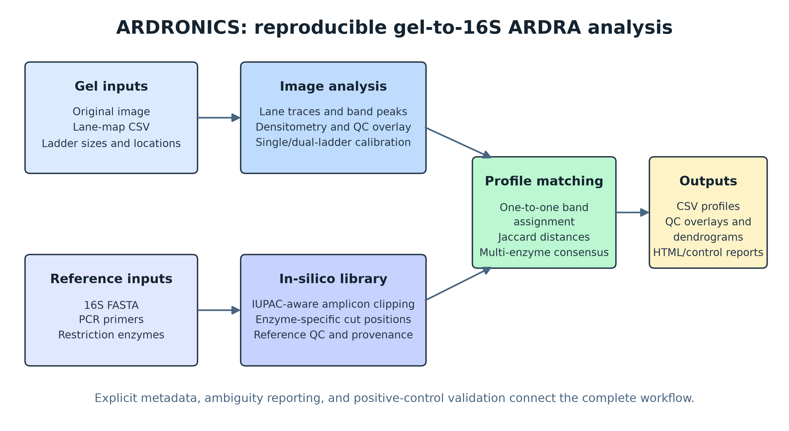

# Summary

Amplified ribosomal DNA restriction analysis (ARDRA) distinguishes microorganisms by comparing DNA fragment patterns produced when restriction enzymes cut an amplified ribosomal RNA gene. ARDRONICS is an open-source Python pipeline that connects gel-image interpretation with this comparison. It detects lanes and bands at native image resolution, estimates fragment sizes from one or two molecular-weight ladders, records densitometry values, simulates restriction digests from 16S reference sequences, and ranks reference profiles using one-to-one band matching and Jaccard distances. It also supports multiple-enzyme consensus, positive-control checks, and explicit reporting of ambiguous matches.

The software provides a command-line interface, JSON experiment configuration, lane-map CSV files, quality-control overlays, tidy CSV outputs, dendrograms, and an HTML report. ARDRONICS is designed for researchers who need an inspectable and reproducible bridge between gel documentation and sequence-derived ARDRA libraries, without requiring a trained vision model or proprietary gel-analysis software.

# Statement of need

ARDRA remains useful for low-cost isolate screening and comparison of microbial communities, but its computational workflow often spans separate tasks: measuring bands on an image, estimating molecular sizes, generating theoretical restriction profiles, and comparing patterns. Manual transcription can introduce lane and size errors, while custom scripts frequently encode particular primer sets, directory layouts, or enzyme combinations. A sizing library alone cannot resolve these problems: pixel migration is not interchangeable with base-pair length, and references lacking primer-defined ends have uncertain terminal fragments.

ARDRONICS addresses this gap by preserving experimental metadata and uncertainty throughout the analysis. Users specify ladder identities, lane roles, digest enzymes, PCR primers, and reference FASTA sequences. The software fails loudly on ladder-count mismatches, supports manual coordinate review, marks unclipped references separately, and identifies tied or incomplete matches. These choices are intended to make ARDRA results easier to audit and reproduce rather than to hide measurement uncertainty behind a single organism label.

# State of the field

General-purpose tools such as ImageJ can measure gel bands [@schneider2012imagej], and GelJ provides DNA-fingerprint image analysis and comparison [@heras2015gelj]. Instrument-associated packages and commercial suites provide additional gel-documentation workflows. Sequence tools such as EMBOSS `restrict` [@rice2000emboss] and Biopython's restriction implementation [@cock2009biopython] can generate theoretical digest products, but they do not connect those products to native gel images and experimental lane metadata.

ARDRONICS combines these steps in a Python-native workflow. Its distinct contribution is not a new restriction-site algorithm or a general image editor; it is the explicit linkage of reviewed gel coordinates, single- or dual-ladder calibration, primer-aware 16S library generation, one-to-one tolerant band assignment, multi-enzyme consensus, and control validation. This integrated design also distinguishes it from fitting a black-box image classifier: every intermediate profile and calibration remains available for inspection.

# Software design

ARDRONICS uses OpenCV and NumPy for image arrays [@bradski2000opencv; @harris2020numpy], SciPy for peak detection, interpolation, optimization, and clustering [@virtanen2020scipy], pandas for tidy tabular exchange [@mckinney2010pandas], and Matplotlib for dendrograms [@hunter2007matplotlib]. The architecture separates gel analysis, in-silico digestion, lane manifests, profile I/O, matching, and reporting.

{#fig:workflow}

Gel bands are detected from per-lane intensity traces after morphological background estimation. A shape-constrained interpolator maps migration to log-transformed fragment size [@fritsch1980pchip]. When ladders occur on both sides of a gel, corresponding ladder positions are interpolated across lanes before fitting each lane, correcting linear migration smile without downsampling the image. Manual lane centers and ladder positions provide an explicit fallback for difficult images.

For reference generation, degenerate International Union of Pure and Applied Chemistry (IUPAC) bases are honored during primer matching, and both primers are retained in the amplicon. Restriction positions come from Biopython's enzyme definitions. Records without a valid primer-defined amplicon fail by default; an optional unclipped mode labels them `ok_unclipped` so terminal-fragment limitations remain visible.

Observed and reference bands are paired by a minimum-cost one-to-one assignment subject to a base-pair tolerance. Similarity is calculated from the resulting intersection and union, rather than allowing one strong band to match several neighbors. Consensus averages distances equally across enzymes and requires complete reference coverage. It cannot resolve organisms that remain identical across every tested enzyme, and such outcomes are reported as ambiguous.

# Verification and technical validation

The current release includes 29 automated tests covering enzyme cut coordinates, IUPAC primer matching, numeric legacy-profile conversion, one-to-one assignment, multi-enzyme coverage, synthetic gel sizing, inverted images, dual-ladder correction, lane-map parsing, positive controls, and complete image-to-identification runs. Statement coverage is 89% overall, including 92% for digestion and 97% for matching. Static analysis passes, wheel and source distributions build successfully, and installed dependencies pass a compatibility check.

Synthetic gels with known migration relationships test fragment-size recovery to within 2% and exact identification in controlled end-to-end examples. Supplied public figures exercise difficult real-image conditions rather than biological ground truth. These include a 20-lane gel with two 13-band ladders and a 14-lane AluI gel with manually reviewed ladder coordinates. Additional four-panel ARDRA figures are processed separately for HaeIII, MspI, RsaI, and AluI. A downloaded NCBI example set currently yields 19 accessions and 531 theoretical fragments, with accession provenance and primer/QC status retained.

These checks verify computational behavior and reproducibility, not taxonomic accuracy. In particular, weak matches obtained from public images without complete experimental metadata are retained as diagnostic examples, not reported as validated identifications. The package documentation emphasizes that a sequence-derived library does not replace a molecular-weight ladder.

# Research impact statement

ARDRONICS provides reusable infrastructure for laboratories that need transparent ARDRA analysis but lack a maintained pipeline connecting image measurement to sequence-derived references. Its research-ready signals include an OSI-approved MIT license, an installable package, a detailed user guide, machine-readable lane and experiment metadata, reproducible public-reference downloads, and automated tests that include real-image regression cases. Outputs are designed for subsequent ecological or comparative analysis rather than a single hard-coded experiment.

No external adoption or independent biological benchmark is claimed at this draft stage. The immediate significance is a reproducible foundation on which controlled comparative studies can be conducted and reported without retrofitting provenance or uncertainty metadata.

# Planned biological validation

Prospective validation will use blinded replicate gels of confirmed isolates, documented ladder products, multiple restriction enzymes, and both primer-complete reference sequences and typical public 16S records. Band-level precision and recall, absolute sizing error, top-one and top-three identification accuracy, ambiguous-call rates, and the improvement from multi-enzyme consensus will be measured against independent isolate identifications. Positive controls will define matching tolerances before unknowns are evaluated. Capillary-electrophoresis fragment sizes will provide an independent sizing reference where available. These data and analysis scripts will accompany a future revision of this manuscript.

# Availability

ARDRONICS is distributed under the MIT license. Source code, the complete user guide, example configurations, the workflow figure generator, and automated tests are included in the project repository. The public repository URL and versioned archive DOI will be inserted before submission.

# AI usage disclosure

Generative AI (Cline) was used to assist software implementation, refactoring, test and documentation generation, figure creation, and manuscript drafting. Verification included executable unit and integration tests, synthetic ground-truth cases, real-image quality-control review, static analysis, dependency checks, and package builds. Biological validation is explicitly separated from these computational checks. The authors are responsible for reviewing the generated code, scientific claims, references, and manuscript before submission.

# References

